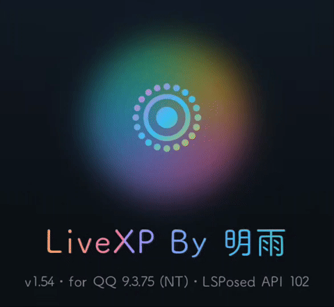
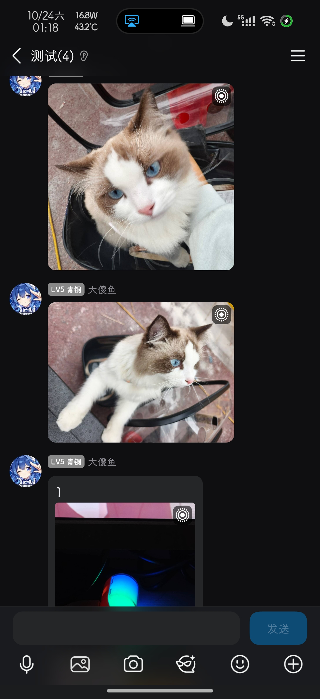
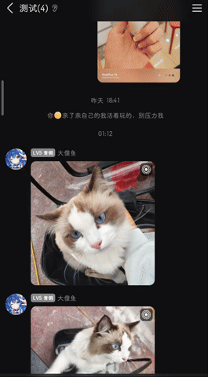

# LiveXP

LiveXP 是一个实现 QQ 实况功能的开源 Xposed 模块。
在聊天界面检测**实况图片**(Live Photo / Motion Photo),给对应气泡加「实况」角标;点开大图自动播放内嵌动态视频。

源码仓库(GPL-3.0,持续更新):https://github.com/mingyu0401/LiveXP

> **当前版本 v1.71**(versionCode 87)

## 功能

- **实况角标**:聊天里的实况图片气泡右上角显示白色点环图标,多图消息逐张标注
- **实况播放**:点开已确认的实况图自动播放一次内嵌视频,右上角留实况图标作重播按钮。自 v1.71 起直接播放提取出的**原始视频切片**(只拷字节、不重编码),起播明显变快
- **翻页续播**:相册内左右滑动切到下一张实况图自动播放,拖动即停播
- **实况发送**:发图时可勾选把实况内嵌的原始视频直接发出(见下文「解析实况」)

## 实况角标

## 实况播放

点开实况图自动播放一次内嵌视频,播完回到照片;左右翻页会自动续播。

## 实况图检测说明

> 实况图默认仅检测 1MB 以上文件,是实现原理导致。目前已实测 OPPO、小米实况图,其他待测。

## 实况检测大小阈值

在 QQ 设置 → 「LiveXP 模块」(或独立 App 关于页)的「实况检测大小阈值」滑块调整:

- 默认 **1MB**,可在 **100KB ~ 10MB** 间按 100KB 步进调整;松手即保存,下次检测立即生效,无需重启 QQ
- 配置存放在 `/storage/emulated/0/Android/data/com.tencent.mobileqq/LiveXP/detect_threshold.txt`,被手改成非法值时自动回退 1MB
- **注意**:调小阈值会让更多文件进入扫描,提高 CPU 占用与耗电,没有需要请保持默认

## 用法

在 LSPosed 里启用模块并勾选 QQ 作用域,重启 QQ:

- 在 QQ 内发/收几张 Android 实况图片的原图,享受官方 QQ 鸽了不知道多久的实况功能
- QQ 设置页出现「LiveXP 模块」入口,点进关于页有一些信息

> **发送提示**:必须在 QQ 发送/接收**实况照片原图**。不要压缩图片,也不要通过系统「分享」把图片发到 QQ(一加相册分享到 QQ 会破坏实况数据,模块将识别不到。)

## 解析实况(发送)

发图片时,在单图预览页底部「原图」右边有一个「解析实况」按钮(半屏相册面板和全屏图库两条路径都有)。勾选后模块立刻在后台解析当前这次选中的图:

- **不是实况图**:按钮显示「非实况图」,发送行为和不勾选完全一样,发出去的还是原图
- **是实况图**:按钮显示「已解析 ✓」,点发送会把这张图换成实况内嵌的**原始视频**发出——不重编码、不拼接、不改时长,对端收到的是标准 MP4
- 视频复用查看实况时的那份提取缓存,发送链路不产生额外副本
- 解析失败或还没解析完就点了发送,一律静默按原图发出,不会挡住发送流程
- 勾选态只属于当前这次选择:发送完成(成功/失败/取消)、关掉预览窗口、退出相册底栏都会回到未选中

## 已知问题

- **全屏相册发送**:从全屏图库直接点发送时,仍可能发出压缩图片而不是视频,修好前请先用半屏面板发送
- **全屏相册「幽灵选择」**:未选中的缩略图也可能显示选中角标,不影响实际发送清单,但确实碍眼,待修

## 反馈问题

提交 issue 时请尽量附上模块日志文件,路径是:

`/storage/emulated/0/Android/data/com.tencent.mobileqq/LiveXP/livexp.log`

最好再附一段**视频或动图**示意 bug 的复现过程。issues 请提到源码仓库:https://github.com/mingyu0401/LiveXP/issues

不接受任何非 LSPosed 框架的问题。

## 兼容性

- 已实机实测通过:OPPO、小米
- 仅本机测试通过:荣耀、魅族、三星、vivo 单文件、谷歌原生
- 苹果(QQ 转码无解?)、华为(不道啊)、vivo 双文件(QQ 发送层不带 MP4 信息)

## 已验证的环境

- KSU + LSPosed 2.2.1(7925)+ Android 17(arm64)
- QQ 9.2.66 / 9.3.70 / 9.3.75 测试通过(疑似适用范围很广)

## 未完成工作

- **HDR 渲染**:没肘赢系统优秀的 HDR→SDR 渲染管线,实况图多为 HDR 信息,播放开始的前 0.7 秒可能有较大的亮度变化
- **适配范围**:除 OPPO、小米外的其他机型实况照片尚未实测,QQ 版本测试不多(但应该很广),可能存在兼容性问题

## 致谢与开源说明

- **[QAuxiliary](https://github.com/cinit/QAuxiliary)** —— 提供了很多思路
- **FUNBOX** —— 本人最喜欢的模块,给了我很大的动力
- [LSPosed](https://github.com/LSPosed/LSPosed)、[XposedBridge](https://github.com/rovo89/XposedBridge)、[AndroidX](https://github.com/androidx/androidx) 还有我可爱的群友们 等等

完整清单也在模块关于页底部的「致谢和开源使用说明」里。以上项目版权归各自作者所有。

## 许可证

本项目以 [GPL-3.0](LICENSE) 协议开源,Copyright (C) 2026 明雨 (mingyu0401)。

分发或修改后的版本需同样以 GPL-3.0 开源并提供源码。仅供学习与个人使用,请勿用于修改 QQ 服务器数据或商业用途。

## 赞助

功能全部免费,自愿赞赏,不打赏也完全不影响使用。

